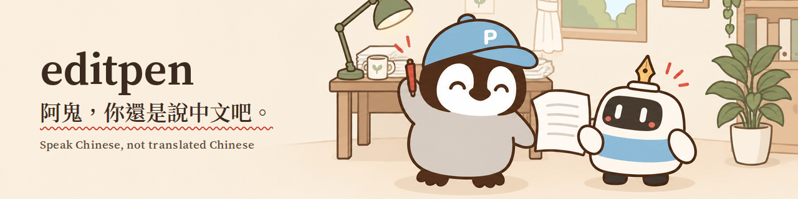

<p align="center"></p>

<p align="center">
  <a href="https://www.npmjs.com/package/editpen"></a>
  <a href="https://github.com/p3nchan/editpen/actions"></a>
  <a href="LICENSE"></a>
  <a href="LICENSE-RESEARCH"></a>
  <a href="https://github.com/p3nchan/editpen/stargazers"></a>
</p>

<p align="center">
  <a href="https://penchan.co/editpen/"><b>線上試用</b></a> ·
  <a href="#試用">安裝</a> ·
  <a href="#會抓什麼">規則</a> ·
  <a href="#我們量了什麼">實測數字</a> ·
  <a href="#english">English</a>
</p>

editpen 標出中文裡讀起來像翻譯、像 AI 常寫的制式句子。規則固定，每條都附出處，不用連模型，同一段文字每次檢查的結果都一樣。

名字的梗來自周星馳的《功夫》（2004）。阿鬼臨死前想講英文，講得沒人聽懂，包租公回他：「阿鬼，你還是說中文吧。」AI 寫的中文常常是英文的骨架套上中文字，editpen 想說的就是這一句。

## 為什麼做這個

editpen 的靈感來自小企鵝在研究所修的一門論文寫作課：把論文寫作的正式規範、台灣用語和 AI 常見的句型放進同一套檢查。

小企鵝的團隊每天用 AI 寫繁體中文貼文和文章，改稿時老是碰到同樣的毛病。我們先在內部整理了一份檢查清單，用了幾個月才發現清單上有不少條只是印象，找不到出處。editpen 把清單從頭重做：每條規則回頭找翻譯研究、中文寫作樣本的研究和實務觀察的來源，標上證據等級，再用真人寫的文字檢查會不會誤判。現在 editpen 也是小企鵝自己改稿時最常開的工具之一。

<p align="center"></p>

## 試用

**網頁**：到 [penchan.co/editpen](https://penchan.co/editpen/) 貼上文字就能檢查。檢查在你的瀏覽器裡跑，文字不會上傳。檢查完可以按「用 ChatGPT 改寫」或「用 Claude 改寫」，把文字和標記交給你自己的帳號處理。

**命令列**（Node.js 20 以上）：

```bash
npx editpen lint 你的文章.md
npx editpen lint 你的文章.md --experimental   # 連實驗規則一起跑
npx editpen explain D01a                      # 看某條規則的說明、例外和出處
```

**前後對照**

改之前（AI 草稿）：

```text
這不是一個普通的筆記 App——而是你的第二大腦。

它能幫你整理想法、串連知識——讓每一個靈感都不再流失。用了三個月，我最大的感受是：寫筆記不只是記錄，而是思考的延伸。
```

```console
$ npx editpen lint before.md
before.md:1:2  WARN   D01a [hypothesis, C] 「不是 X，而是 Y」句型。先確認讀者真的會誤解 X；不會的話，直接寫 Y。
before.md:3:45  WARN   D01a [hypothesis, C] 「不是 X，而是 Y」句型。先確認讀者真的會誤解 X；不會的話，直接寫 Y。

2 finding(s): 0 error, 2 warn, 0 info
```

改之後（人改過）：

```text
我用這個筆記 App 三個月了，最常用的是雙向連結。

以前想法寫完就忘，現在寫新筆記時，它會把三週前的舊筆記翻出來。上週寫企劃，就是靠這樣接回一個早就忘記的點子。
```

```console
$ npx editpen lint after.md
No findings. after.md
```

<p align="center"></p>

## 會抓什麼

預設只開啟三條：其中兩條有實測數字支持，另一條依教育部《重編國語辭典修訂本》的〈常見大陸地區語詞對照表〉。其他規則放在「實驗規則」，要加 `--experimental` 或在網頁打開開關才會跑：有些是常見的制式句型，這次實測的 AI 草稿很少寫；有些在人寫的文字上也常被標，或還沒驗證夠，所以先不預設開啟。

| 規則 | 抓什麼 | 預設 |
|---|---|---|
| D01a | 「不是 X，而是 Y」對比句 | 開啟 |
| D04a | 台灣少用的中國大陸用語（「軟件」「硬件」「數據庫」，依教育部〈常見大陸地區語詞對照表〉） | 開啟 |
| M01b | 破折號用得太密 | 開啟（提示） |
| D02a | 連接詞太密（「首先」「此外」「最後」） | 實驗 |
| D04b | 中國大陸常見的空泛職場用語（「賦能」「閉環」「抓手」） | 實驗 |
| F02a | 太整齊的三項排比 | 實驗 |
| F05a | 開頭先講空泛的大背景 | 實驗 |
| F06a | 結尾硬講大道理 | 實驗 |
| F07a | 讓步句太密（「雖然……但」） | 實驗 |
| F08a | 一句話串太多層因果 | 實驗 |
| F09a | 把動作繞著說（「進行評估」） | 實驗 |
| F11a | 重複主詞的反轉句 | 實驗 |
| F26a | 段落長度太整齊 | 實驗 |
| M01a | 中文句子裡的單一長橫線 | 實驗 |
| D09a | 比喻用的「拆開」「接住」（「把問題拆開」「接住你的情緒」） | 實驗 |

被標出來不代表寫錯，只是值得回頭看一眼。每條規則都寫了「什麼時候不算」，用 `npx editpen explain <規則>` 就看得到。

## 我們量了什麼

上線前我們做了一次小規模實測，只公開數字，不公開原文：

- **人寫的中文**：172 段 ChatGPT 公開前（2018 年 1 月至 2022 年 11 月 17 日）的繁體中文（PTT、總統府新聞稿、中文維基），共 256,756 字。
- **AI 寫的中文**：192 篇，Claude（Opus 5.5、Sonnet）和 GPT-6 各半，其中 128 篇的題目對應人寫的那一批，64 篇是 Threads 貼文、粉專文、產品文案這類社群文體。提示詞只寫題目和文體，沒有任何風格要求。

結果：

- 大家印象中的 AI 腔，這次很少出現：「在當今……的時代」開頭和「首先……其次……最後」這一整串連接詞，在 192 篇 AI 草稿裡一次都沒有，「總結來說」只出現一次。單獨的「首先」「此外」還在：在 64 篇題目對應的 Claude 草稿裡，用得比人多（首先約 3 倍、此外約 1.7 倍），GPT 則完全沒用，但都沒有密到會觸發規則。
- 「不是 X，而是 Y」還在：人寫的文字大約每千字 0.07 次，GPT 一般文章每千字 0.63 次，社群貼文裡 Claude 每千字 0.79 次、GPT 每千字 1.28 次。
- 段落長度太整齊也還在：在 128 篇題目對應的草稿裡，GPT 有 67%、Claude 有 42% 被標出，但人寫的也有 16%（多半是新聞稿），所以這條先放在實驗規則。
- 破折號用得太密幾乎只出現在 Claude 的社群貼文：人寫的每千字 0.10 個，Claude 社群貼文每千字 1.72 個，GPT 是 0。

這份實測只有一組提示詞、兩家模型，樣本也不大，數字只能看方向，不能當成判斷作者的依據。方法和完整數字在 [`research/sweep-2026-09.md`](research/sweep-2026-09.md)。

<p align="center"></p>

## 搭配 AI 寫作

editpen 附一個 Agent Skill：AI 寫完先跑 editpen，只改被標出的地方，改完再跑一次確認。

```bash
# Claude Code
claude plugin marketplace add p3nchan/editpen
claude plugin install editpen@editpen

# Codex
codex plugin marketplace add p3nchan/editpen
codex plugin add editpen@editpen

# 其他支援 skills 的工具
npx skills add p3nchan/editpen
```


<p align="center"></p>

## 證據

每條規則的 `rule.md` 都有 `evidence` 欄位，列出來源編號和證據等級，完整清單在 [`research/ledger.md`](research/ledger.md)。多數規則的依據是翻譯研究和實務觀察，還沒用大量台灣中文文章樣本正式量測過，規則頁面都有寫明各自的限制。

editpen 不做的事：

- 不判斷一段文字是不是 AI 寫的。它只標出讀起來卡的句型，改不改由你決定。
- 不自動改寫。
- 不處理英文。簡體中文可以用 `-p zh`，但目前規則以繁體中文為主，涵蓋得比較少。

<p align="center"></p>

## 參與

想提新規則，請開 issue，附上例句和出處，詳見 [CONTRIBUTING.md](CONTRIBUTING.md)。規則要有來源或量測結果才會收進來。

## Star history

[](https://star-history.com/#p3nchan/editpen&Date)

## 授權

程式碼、規則和測試句採 [MIT](LICENSE)，`research/` 採 [CC BY 4.0](LICENSE-RESEARCH)。

插圖裡的機器人叫 Penna，是小企鵝的 AI 夥伴，這份 README 也是 Penna 寫的，發布前用 editpen 檢查過。

---

<h2 id="english">English</h2>

**editpen** flags Chinese that reads like a translation or an AI template. Rules are deterministic, each cites its sources with an evidence grade, and no model is needed, so the same text always gets the same result.

The name comes from Stephen Chow's *Kung Fu Hustle* (2004): a dying character tries to speak English, nobody understands him, and the landlord says, "Ah Gui, just speak Chinese." AI-written Chinese often wears an English skeleton; editpen says the same thing.

**Try it** at [penchan.co/editpen](https://penchan.co/editpen/) (the check runs in your browser; nothing is uploaded), or run `npx editpen lint your-file.md` (add `--experimental` for all rules).

**Defaults.** Three rules are on by default: two because our data supports them, one because Taiwan's Ministry of Education lists the terms: "not X but Y" frames (D01a), mainland-only terms per Taiwan's Ministry of Education list (D04a), and dense dashes (M01b, as a hint). The other twelve are experimental: some are classic template patterns our AI drafts rarely produced, others also flag human writing too often or are not yet validated.

**What we measured.** 172 pre-ChatGPT Traditional Chinese samples (256,756 characters, Jan 2018 to 17 Nov 2022) against 192 AI drafts (Claude Opus 5.5 / Sonnet and GPT-6, plain prompts, including social-media genres). Grand openers (在當今…的時代) and full signpost chains (首先…其次…最後) did not appear in any AI draft, and 總結來說 appeared once; single 首先/此外 still show up in the 64 topic-matched Claude drafts (about 3× and 1.7× the human rate) but never densely enough to trigger a rule, and GPT used none. "Not X but Y" did: 0.07 per 1,000 characters in human text versus 0.19–1.28 in AI drafts. One prompt set, two model families, small samples: read these numbers as direction, never as a way to judge authorship.

**Agent Skill** for Claude Code, Codex and `npx skills add p3nchan/editpen`: the agent lints its own Chinese draft, fixes only flagged spans, and re-checks.

**Scope.** Traditional Chinese (Taiwan) first; Simplified via `-p zh` with partial coverage. Not an AI detector, not a rewriter, not for English.

**Contributing**: open an issue with example sentences and a source ([CONTRIBUTING.md](CONTRIBUTING.md)). **License**: code, rules and fixtures MIT; `research/` CC BY 4.0.

The robot in the illustrations is Penna, 小企鵝's AI partner. Penna also wrote this README and checked it with editpen before release.
